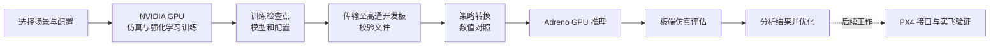

# FLARE on Qualcomm

在 NVIDIA GPU 上训练无人机吊挂强化学习策略，迁移到高通开发板的 Adreno GPU 推理，并通过板端仿真评估。工程按场景管理环境、模型和训练配置。



板端使用 Vulkan 物理仿真和 OpenCL 策略计算；观测、混控和数据传递包含 CPU 工作。工程尚未接入 PX4 实飞控制。

## 使用流程

1. 在 NVIDIA 训练工程中选择场景及对应的环境、模型和训练配置，完成仿真训练。
2. 将检查点与同一次训练保存的配置文件传输到开发板，并校验文件。
3. 使用对应场景的导入工具转换策略，核对配置、网络结构与转换前后的输出。
4. 使用对应场景的评估入口运行板端仿真，分析回合、跟踪误差和负载状态，再决定如何优化。

各场景的模型和网络结构可能不同，必须使用匹配的配置、导入工具和评估入口；尚未适配的场景需要先完成适配和验证。当前 GPU 推理采用浮点策略，无需量化。板端训练可用于调试，主要训练推荐在 NVIDIA GPU 上进行。

## 准备开发板

按照 [Radxa Q6A 官方教程](https://docs.radxa.com/dragon/q6a)和[环境准备说明](docs/MODEL_MIGRATION.md)配置驱动与系统依赖，然后获取工程：

```bash
git clone --recurse-submodules git@github.com:sheetung/flare_q6a.git
cd flare_q6a
scripts/setup.sh
```

## 工程目录

```text
flare_q6a/
├── envs/       # 场景环境与仿真接口
├── assets/     # 模型与资源
├── config/     # 环境和训练配置
├── runners/    # 策略网络与训练器
└── utils/      # 混控、配置和验证工具
scripts/        # 启动、迁移和评估工具
records/        # 训练与评估记录
```

## 文档

- [模型迁移与环境准备](docs/MODEL_MIGRATION.md)：设备配置、策略接口和迁移说明。
- [刚性绳场景的完整示例](docs/SERVER_S2.md)：训练、迁移、评估命令与已验证结果。
- [更新日志](docs/CHANGELOG.md)：工程修改和验证记录。

评估完成表示流程已运行，不代表策略稳定或可以实飞。仅加载可信来源的模型与配置文件。
