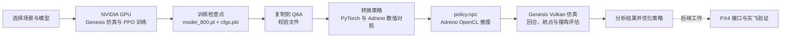

# FLARE on Qualcomm

在 NVIDIA GPU 上训练无人机吊挂策略，迁移到 Radxa Dragon Q6A 的 Adreno GPU 推理，并通过板端仿真评估。场景使用 `s*` 命名，各自配置环境、模型和训练参数。



板端仿真使用 Vulkan，策略网络使用 OpenCL；观测、混控及数据传递包含 CPU 工作。工程尚未接入 PX4 实飞控制。

| 场景 | 任务 |
| --- | --- |
| `s1_waypoint_passing` | 原 FLARE 柔性绳航点跟踪 |
| `s2_waypoint_passing_rigid` | 服务器 S2 双关节刚性绳航点跟踪 |

其他服务器场景需逐项迁移验证。旧的 `s1_waypoint_passing_rigid` 保留兼容，它与 S2 使用不同模型。

## S2 完整流程

### 1. NVIDIA 训练

在包含 S2 场景的 FLARE 服务器工程中运行：

```bash
cd /home/sheetung/flare_ws/Flare
../.venv/bin/python -u train.py -e s2_waypoint_passing_rigid \
  -B 2048 --max_iterations 800 --device cuda:0
```

训练日志目录中会生成 `model_800.pt` 和 `cfgs.pkl`。S2 是服务器工程的场景，不能使用原版 FLARE 的 S1 训练入口代替；服务器代码版本和配置见 [S2 迁移记录](docs/SERVER_S2.md)。

### 2. 复制到 Q6A

将同一个训练日志目录中的 `model_800.pt` 和 `cfgs.pkl` 一起复制到 Q6A，保存到新目录，例如 `records/run_s2_input/`。本次使用 SSH 传输，并在服务器与本机分别计算 SHA256，确认文件一致。只加载可信来源的模型和配置文件。

### 3. 导入并评估

首次在 Q6A 部署时，按[板卡准备说明](docs/MODEL_MIGRATION.md)安装驱动与依赖，然后获取并安装工程：

```bash
git clone --recurse-submodules git@github.com:sheetung/flare_q6a.git
cd flare_q6a
scripts/setup.sh
```

```bash
scripts/run.sh scripts/import_server_s2.py \
  --checkpoint records/run_s2_input/model_800.pt \
  --config records/run_s2_input/cfgs.pkl \
  --output records/run_s2_transfer/policy.npz

scripts/run.sh scripts/eval_server_s2.py \
  --checkpoint records/run_s2_transfer/policy.npz \
  --output records/run_s2_evaluation --envs 4 --episodes 4 --steps 1501
```

导入器核对场景配置和网络结构，并比较原 PyTorch 与 Adreno 的 Actor 输出；生成的 `policy.npz` 用于 GPU 推理，无需量化。评估输出目录必须是新目录，结果保存在 `evaluation.json` 和 `episodes.jsonl`。

本次在 RTX 5060 Ti 上完成 800 轮、约 1.64 亿采样步；本机评估中 4 个回合均达到 15.01 秒上限，共到达 76 个航点。平均世界竖直摆角约 48°、峰值约 111°，仍需优化抑摆，不能据此判定实飞可用。详见[训练记录](records/server_s2_800_training_summary_20261101.json)和[评估记录](records/server_s2_800_evaluation_20261101.json)。

本机也可调试训练，默认 4 个并行环境；主要训练仍推荐在 NVIDIA GPU 上完成：

```bash
scripts/run.sh scripts/long_training.py -e s2_waypoint_passing_rigid
```

S1 柔性任务的迁移方法见[模型迁移文档](docs/MODEL_MIGRATION.md)；设备配置参考 [Radxa Q6A 官方教程](https://docs.radxa.com/dragon/q6a)。每次工程修改记录在[更新日志](docs/CHANGELOG.md)。
